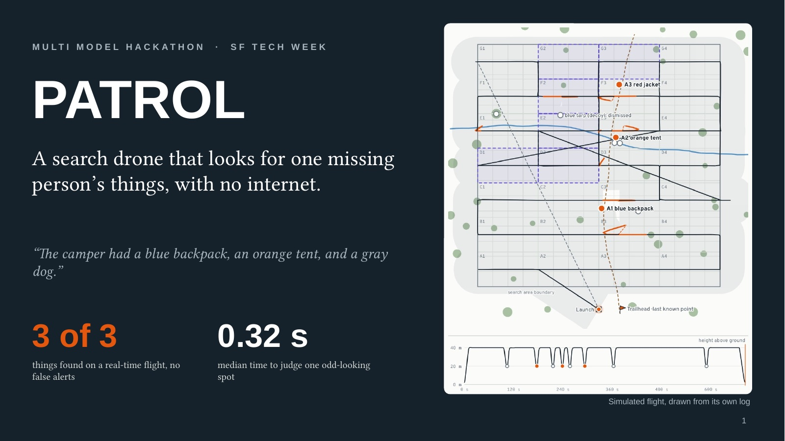
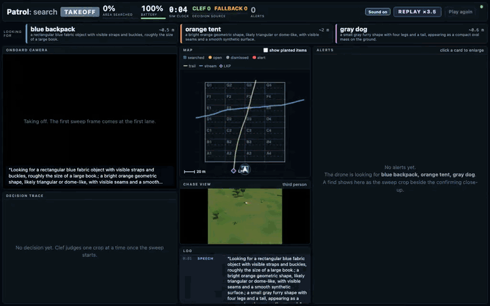
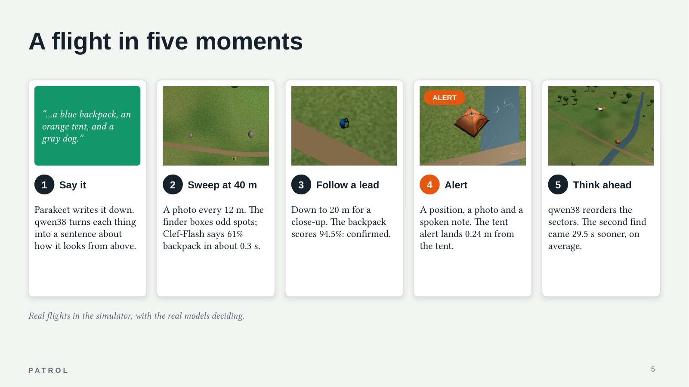
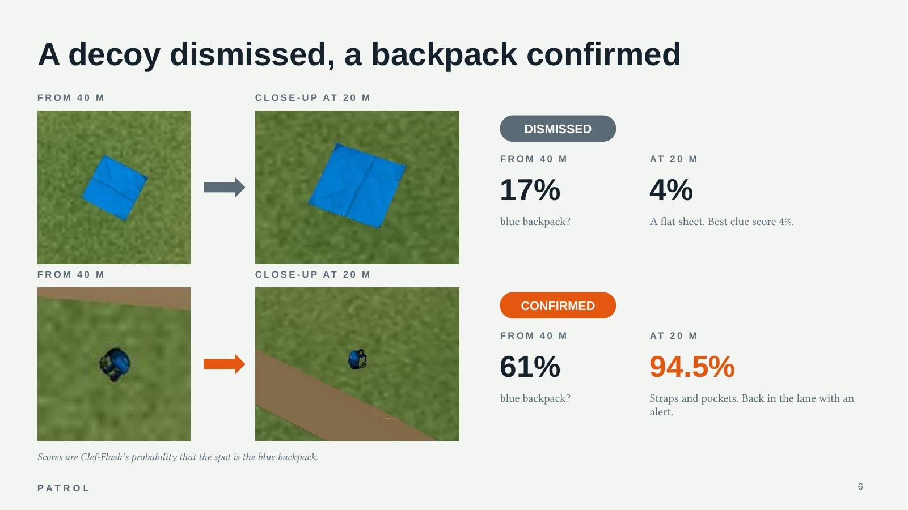
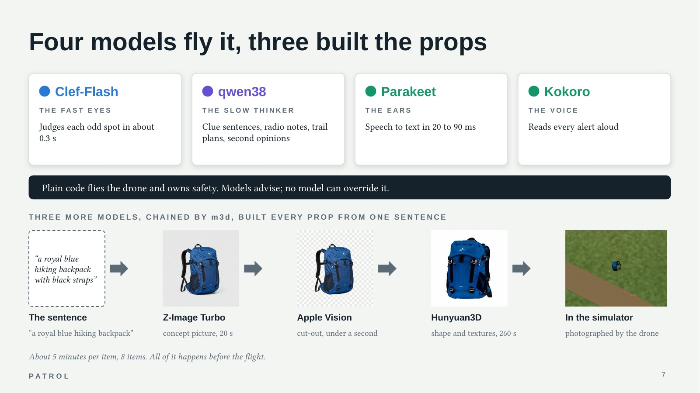
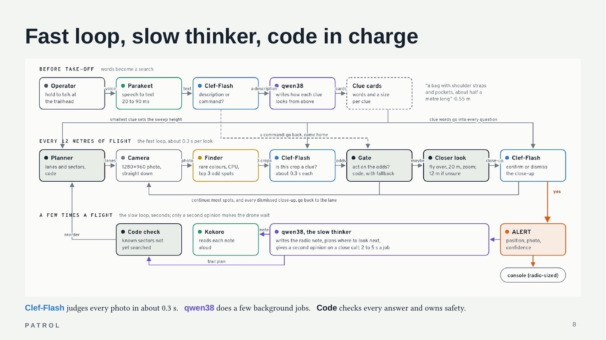
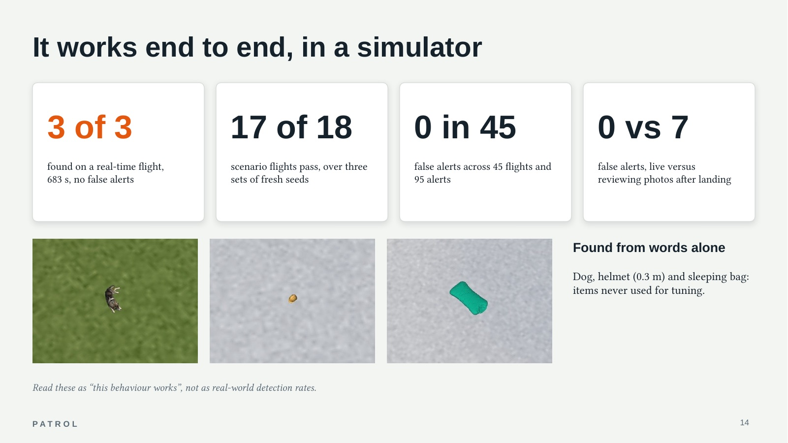
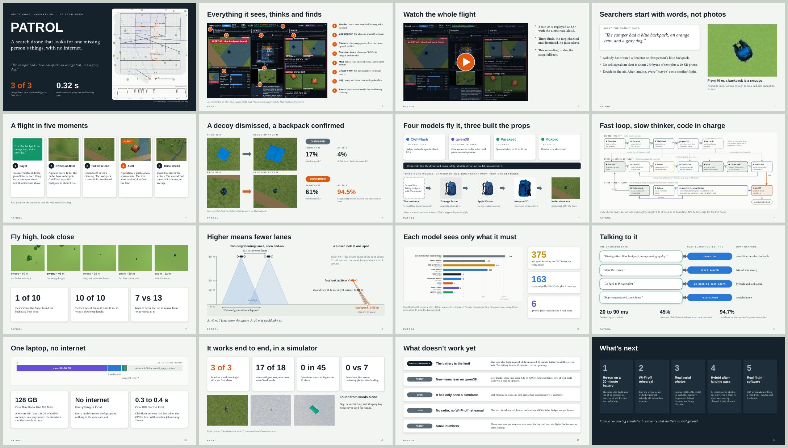

  

  <b>A family says what the missing person had with them. A drone searches for those things, from words alone, with no internet.</b> 
  Four AI models on one laptop · built in a day for the Multi Model Hackathon, SF Tech Week 2026

🏆 <b>Winner of the Multi Model Hackathon, SF Tech Week 2026.</b>

📖 <a href="https://patrol-31d53272.base44.app"><b>Read the illustrated explainer and the slides in your browser</b></a>

> *"The camper had a blue backpack, an orange tent, and a gray dog."*

An operator said that into Patrol's console during a test. Patrol turns words like these into a search. It sweeps the
ground from 40 metres up, drops down for a closer look at anything that might match, and sends back a position, a photo
and a short note when it finds something. Four AI models share the work on one laptop, and none of them calls the
internet. The drone and the hillside are simulated in MuJoCo, with the real models making every decision.

  
   
  A whole search, sped up 16×. <a href="explainer/assets/demo-flight.mp4?raw=true"><b>▶ Watch the full flight with sound (3 min 23 s)</b></a>: three finds, a decoy tarp checked and dismissed, no false alerts.

## Why it matters

When someone goes missing in the backcountry, the first useful facts usually come from family: what the person was
wearing, what they carried, whether the dog was with them. **Nobody has trained a detector on this person's blue
backpack**, so a computer that helps has to work from words. And out there it usually can't send video anywhere,
because there is no cell signal.

So Patrol decides **in the air**, not after landing:

- **The closer look.** From 40 m a backpack is a smudge about 22 pixels across. The drone can drop down and settle a
  "maybe" while it is right there. After landing, every "maybe" costs another flight.
- **Time.** A find during the flight beats a find an hour later at a laptop. Cold, injury and avalanches don't wait.
- **Bandwidth.** An alert is about 270 bytes of text plus a 20 KB photo, small enough for a radio link.

Patrol is decision support: a person reviews every alert. It would sit beside the tools search teams already use, not
replace them. The simulator proves how the system behaves, not how well it would detect things on a real hillside.

## A flight in five moments

1. **You say what you're looking for.** Parakeet writes it down, Clef-Flash decides it is a description rather than a
   command, qwen38 turns each thing into a sentence about how it looks from above with a rough size, and Kokoro reads
   the list back. The smallest item sets the sweep height.
2. **It sweeps from 40 m.** A photo every 12 m. A colour-rarity finder boxes the three oddest spots in each photo, and
   Clef-Flash scores each 256-pixel crop against the clues in about 0.3 s.
3. **It follows a lead.** On a "maybe" the drone leaves its lane, stops 20 m from the spot (then 12 m if still unsure)
   and takes an angled zoom close-up. Still unsure at 12 m? qwen38 gives a second opinion.
4. **It raises an alert.** A position, the sweep crop beside the confirming close-up, and a radio note read aloud.
5. **It thinks about where to look next.** qwen38 reorders the remaining sectors along the trail and stream, and the
   sweep carries on.

## Four models fly it, three more built the world

| Role | Model | What it does |
|---|---|---|
| The fast eyes (system one) | **Clef-Flash**, a 9B decision model from Cloudflare (8-bit MLX) | Returns a probability for every answer in one pass, without writing text: is this spot one of the clues, does the close-up confirm it, was that a description or a command. About 0.3 s per spot. |
| The slow thinker (system two) | **qwen38** (Qwen3.8 Flash Next, a vision LLM, 4-bit) | Clue sentences, radio notes, where to search next, and a second opinion when Clef-Flash is unsure. 2 to 5 s per job, kept out of the fast loop. |
| The ears | **Parakeet** TDT v3 (0.6B) | Speech to text for the description and commands, 20 to 90 ms. |
| The voice | **Kokoro** (82M) | Reads the clue list back and every alert aloud, 60 to 250 ms. |
| The spotter | a colour-rarity **anomaly finder** (numpy, not a trained model) | Boxes the three oddest spots per photo, so Clef-Flash looks at three crops instead of a 1280×960 frame. This is what lets the drone fly high. |
| The pilot | **plain code** | Lanes, the gate on every model answer, height band, boundary, battery reserve and the trip home. Models advise; code flies, and no model can override it. |

Every prop (the backpack, tent, dog and decoys) was made from one sentence by [m3d](https://github.com/mthomas100/local-3d),
a local text-to-3D tool chaining Z-Image Turbo, Apple Vision and Hunyuan3D, then dropped into MuJoCo at its real size.

## What has been proven

Every number comes from a recorded run, offline, with the real models, in the simulator:

| Test | Result |
|---|---|
| Real-time flight (683 s, live in the console) | **3 of 3** found, decoy tarp dismissed, no false alerts |
| Six search scenarios × three seed sets, 30-minute battery | **17 of 18** flights pass; the one miss is a sleeping bag the colour finder never boxed |
| Held-out items (never used for tuning), four clues at once | **4 of 4**, no false alerts, within 0.05 m |
| Every finished search flight so far | **0 false alerts** in 45 flights (95 alerts) |
| Deciding live vs reviewing photos after landing (six flights) | both found 14 of 16; **0 vs 7** false alerts, with 4× fewer Clef-Flash calls live |
| qwen38 second opinions at 12 m | **11 of 11** right |
| Only what you said: a dog planted but not described | found the two described items, **never alerted on the dog** |
| Clef-Flash switched off mid-search | finishes the area on FALLBACK, raises nothing, **comes home** |

Read these as "this behaviour works", not as real-world detection rates: the scenes are simulated and the samples are
small. What doesn't work yet: the finder's blind spot, no radio, no Wi-Fi-off rehearsal, no real aerial imagery yet.
Details and evidence: the reports under [`runs/`](runs/).

## The full story

- **In your browser:** [the explainer and a slide viewer](https://patrol-31d53272.base44.app), nothing to download. Same content as the files below,
  plus the animated flight replay.
- **Explainer page:** [`explainer/index.html`](explainer/index.html) (download the `explainer/` folder and open it in a
  browser). The whole project in one page: an animated flight replay, every model, the altitude maths, the faults, and
  where it goes next.
- **Slide deck:** [`explainer/deck/patrol-deck.pptx`](explainer/deck/patrol-deck.pptx) (16 slides, presenter notes in
  [`SPEAKER_NOTES.md`](explainer/deck/SPEAKER_NOTES.md)).

## Try it

**Using a coding agent?** Point it at [`SETUP.md`](SETUP.md): "Set up Patrol on this Mac by following SETUP.md." It
checks your Mac, asks before every large download, wires up the models and proves the result with a test flight.

**By hand:** follow the same file. In short:

1. An Apple Silicon Mac with 32 GB of memory or more.
2. Clef-Flash (10.7 GB) served through the public [`local-decision`](https://github.com/mthomas100/local-decision) repo
   on port 8097.
3. The eight 3D search items: a mesh bundle, or a rebuild with the public [`local-3d`](https://github.com/mthomas100/local-3d)
   (m3d) repo.
4. `tests/e2e_search.sh --only 1,2,3,4 --no-think`, then the live console in your browser.
5. Optional: any local vision chat model on port 8090 (clue wording and alert notes), and
   [`local-voice`](https://github.com/mthomas100/local-voice) for speech.

**No suitable Mac?** [`HOSTED.md`](HOSTED.md) sketches running it with hosted models instead: Clef-Flash on Cloudflare
Workers AI and any vision chat model through a proxy. It is untested and no longer offline.

## What is in this repo

| Path | What |
|---|---|
| `patrol/` | the code: planner, anomaly finder, Clef client, gate, mission, console |
| `bin/patrol` | the command line (`search`, `console`, `fly`) |
| `tests/` | unit tests (`pytest`) and the end-to-end scenarios (`e2e_search.sh`) |
| `fixtures/`, `assets/` | scenario clues and voice clips; each 3D item's description and provenance (meshes are rebuilt, not stored) |
| `runs/` | the recorded runs behind the results: reports, mission logs and score files |
| `demo/` | the recorded fallback flight |
| `explainer/` | the explainer page, its figures and the slide deck |

## Credits

Built on Clef-Flash (Cloudflare, Apache-2.0), Qwen3.8 Flash Next served by ds4, NVIDIA Parakeet TDT v3 (CC-BY-4.0),
Kokoro (Apache-2.0), MuJoCo 3.15 (Apache-2.0), and for the props Z-Image Turbo (Apache-2.0), Apple Vision and
Hunyuan3D 2 / 2.1 (Tencent Hunyuan community licence). Each model keeps its own licence.
